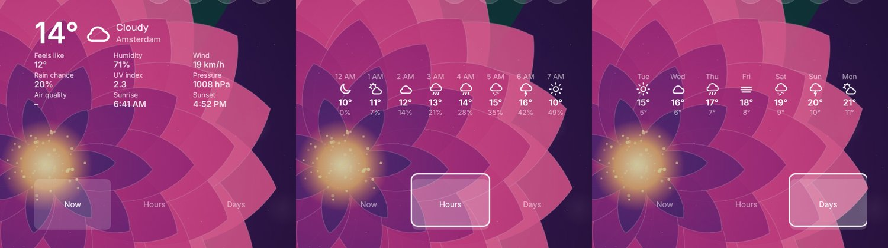
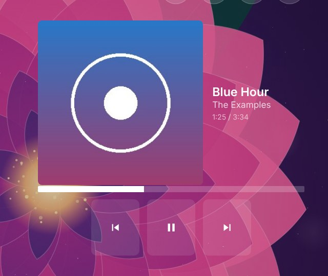
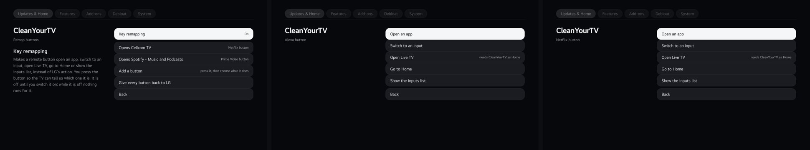
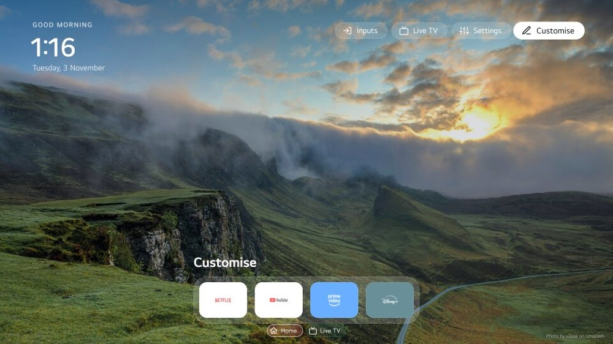

**Update the service first.** The launcher's new cards need service 1.6.16: the manager offers the service update before the launcher.

## New

- **Cards that come with an add-on.** A card can now bring its own page, data from the internet and buttons for the remote: the add-on's service asks, the card's closed frame only draws what it is handed, and the card's buttons take the remote's focus in the top row of Home (OK sends the add-on an action). How to make one: `docs/development/addons.md`. Four cards use it:
  - **Weather forecast**: the weather at a city you choose on your phone, as **Now** (feels like, humidity, wind, rain chance, UV, pressure, air quality, sunrise and sunset), **Hours** and **Days**, with the three views as buttons on the card. From Open-Meteo, no key, only the coordinates leave the TV. By @Edenik (#129).
  - **Spotify now playing**: the cover, title and artist of what plays on your Spotify account, a progress bar, and **Previous**, **Play or pause** and **Next** on the remote (Premium for the buttons). Sign in from your phone with your own Spotify app, so the project holds no credential. By @Edenik (#127).
  - **Hello, name**: "Good evening, Sam", with a name that reads right even when it is Hebrew or Arabic. By @Edenik (#128).

- **Key remapping.** A remote button the TV never uses (the Netflix or Prime key, a colour key) opens an app, an input, Live TV, Home or the Inputs list. In the manager: **Updates & Home > Key remapping**, off until you switch it on. The button is learned from the TV, shown by LG's own name for it, and LG's action for it does not happen. Give every button back with one press, or reboot without the boot scripts. By @Edenik (#137).

- **Photo sources are add-ons.** Wallpapers is now your own photos, uploaded from your phone. **Immich** (your albums) and **Unsplash** (a new landscape photo every few minutes, with the photographer's credit in the corner of Home) are add-ons in **Add-ons > Get more**, and any add-on can now provide photos. A TV that used Immich before keeps its settings and photos until you install the add-on, which takes them over without downloading again. The Unsplash add-on is the integration of @Edenik (#132).

- **Add-ons with a phone page** get **Set up from your phone** on their screen in the manager.
- **Languages.** **Vietnamese** by @hothach1509-eng (#111) and **Hungarian** by @Davhentel (#130), tested on a real TV.
- **Prayer times and Adhkar** cards, each with its own page and code in a closed frame. By @mashhour134 (#121).
- **Luna stdin compatibility**, an opt-in setting for TVs where Luna calls need an open stdin (#55), and a fix that stops LG's own Home processes before the stand-in is unmounted (#56). By @TylerBuza.
- **The weekly trim of the eMMC** and **Trim now** (experimental, issue 100).

## Fixes

- **The manager opens without LG's grey splash and its spinner** when it is started from Customise. By @Edenik (#131).
- **Live TV reloads a stream** whose picture time stops without a waiting event (issue 109).
- **webOS 25 with the Flutter or web Home**: the video output and media services are restarted after SAM (issue 122).

## What to know

The add-ons and cards of this release (Immich, Unsplash, weather, Spotify, Hello) are new. Their code has been tested against stand-ins for Open-Meteo, Unsplash, Immich and Spotify and drawn in the real launcher in Chromium; the authors tried the key remapping, the Hungarian and Vietnamese screens, the Unsplash credit and the manager splash on their own TVs, but nobody has yet tried the add-ons and cards on a real TV with a real account. Please say what you see in an issue.

## Thanks

@Edenik for key remapping, the weather, Spotify and name cards and the Unsplash integration; @TylerBuza, @mashhour134, @hothach1509-eng and @Davhentel for code, prayer times and translations; and everyone who reports what a dev build does on their TV.
