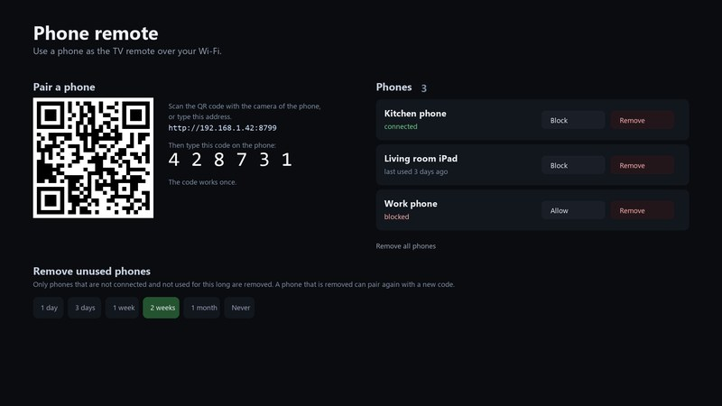

## New

- **Phone remote** (a catalog add-on, off until you install it and switch it on). A phone on the same Wi-Fi becomes the TV's remote: pair it once with a 6-digit code the TV shows, then use the buttons, a **touchpad that moves the TV's real pointer**, a keyboard that types into the field open on the TV, the TV's apps, your Live TV channels and a power button. Each phone can be blocked or removed, and a phone that is not used for a while is removed by itself. The add-on has its own page on the TV (pairing with a QR code, the paired phones). The protocol is written down in `docs/phone-remote-api.md` for other clients. By @Edenik (#152).

- **Add-on repositories.** The TV keeps a list of repositories, managed from the TV and over SSH (`cytv-addons`); the project's own catalog always stays first. Anyone can publish a repository, and the TV warns before it installs code from one that is not the project's. A template for a repository is in `addons/template/` and the guide is `docs/development/addon-repos.md`. By @Tech-Dex (#169).
- **Themes.** **Nord** (dark polar nights and frost blue) by @gasparegas (#179) and **Moon** by @capegf (#177).
- **Languages.** **Catalan** completed by @jmtalarn (#180) and **Dutch** completed to 100% by @gasparegas (#178).
- **Home Assistant cards.** Entity lists can have a dark background and show Home Assistant's own icons, which now load on demand so a card that does not use them stays light, and Horizon gets three more card positions in its right column. By @ramzeka (#173, #174, #182).
- **The pointer on Home.** What is under the pointer is focused the moment the pointer shows, a cursor resting over a tile focuses it, and a click focuses what it opens. By @Black-i (#172).

## Fixes

- **webOS 26: the remote works on Home right after the TV is switched on.** After a wake LG's window manager did not give Home the remote, and nothing worked until Back was held. The launcher now notices that it has no focus and the service lets the Inputs picker take the remote for half a second and give it back, without drawing anything. By @Diplodock (#188, issue 6).
- **Voice on a TV with a 32-bit kernel** says at once that it is not available, instead of failing after an 80 MB download (issue 175).

## What to know

The phone remote and the add-on repositories are new and have only been tried on one TV each (the phone remote on an LG 65UR91006LB, webOS 25). The pairing window, the token handling and the LAN port (8799, open only while the add-on is on and a phone is paired or its pairing window is open) are described in `docs/security.md`. The wake fix is for webOS 26 only and was tried on one OLED65C54LA. Please say what you see in an issue.

## Thanks

@Edenik for the phone remote; @Tech-Dex for add-on repositories; @Diplodock for the wake fix; @Black-i for the pointer; @ramzeka for the Home Assistant cards; @gasparegas, @capegf and @jmtalarn for themes and translations; and everyone who reports what a dev build does on their TV.
