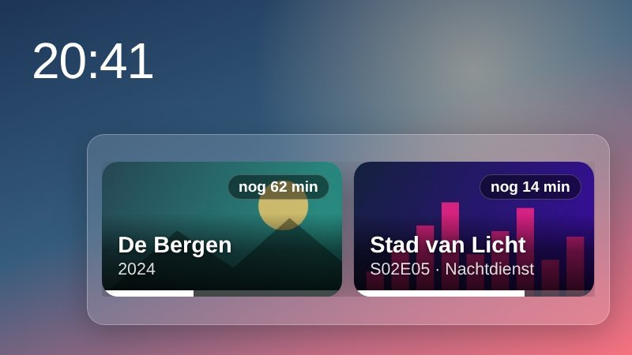

**Update the service first.** The Spotify card's new buttons need service 1.6.17 (they ask the TV to open the Spotify app): the manager offers the service update before the launcher.

## New

- **Jellyfin continue watching** (Add-ons > Get more). A card for Home with where you were in your films and episodes, with the pictures and how far you got, and optionally the next episode of a series you follow. OK on one opens your Jellyfin app on the TV: the official one, Litefin or Moonfin, whichever is installed (Litefin opens the title itself). You sign in from your phone; the password goes to your Jellyfin server once and the TV keeps only the access token. By @larsoss (#154).

- **Spotify card 1.1.** The cover opens the Spotify app on the TV on the song that plays, a new **Play on** button lists the devices of your account to move the music to (and back to the TV), the buttons have a focus ring and answer at once, and the card fits every place on Home. Waking a speaker that Spotify does not list is **opt-in**: switch on "Wake speakers on my network" on the phone page and sign in again; the TV asks "Sign in on this device?" before anything is sent. Cards of add-ons are asked only once a minute while Home is hidden. By @Edenik (#150).
- **A remote button can do nothing.** In **Key remapping**, choose **Do nothing** for a button you never want: LG's own action for it is blocked too. After learning a button, the manager now comes back with it when LG's action covers the screen, and Back returns to the list of buttons. By @Tech-Dex (#148), with a follow-up.
- **Preload policy per app.** In **Experimental**, each preloaded app gets its own policy, and the State row offers only the modes your TV uses. By @Tech-Dex (#149).
- **Running apps lists more.** Back on Home now also lists the CleanYourTV manager (it stays open in the background after you leave it) and the background services of installed apps, such as Stremio's streaming server (about 50 MB), as **"Stremio (in the background)"**. OK stops it, **Close all** includes it, and the app starts it again when it needs it. Never listed: the Homebrew Channel and CleanYourTV's own services. By @Black-i (#160).
- **TV guide (LG tuner)** is an add-on of its own now, built from the guide code of Live TV: it brings the tuner's channels and guide to the Live TV guide, with no channel source inside Live TV (#146, #147).
- **Polish**: 141 more texts translated by @dzienisz (#156).

## Fixes

- **Custom scenes show their pictures** on the TV: the launcher is a file page, so the pictures now load from the service. By @Black-i (#155).
- **An add-on that is switched by an option follows that option**: the Add-ons list showed it as off when the option had turned it on, and switching it asked for a restart it did not need. By @larsoss (#153).
- **A long add-on text on the Add-ons tab scrolls** instead of being cut off. By @Edenik (#145).
- The Preloaded apps screen says what its memory figure is. By @Tech-Dex.

## What to know

The Jellyfin card has been tested against a stand-in for the Jellyfin server and drawn in the real launcher, but nobody has signed in on a real TV with a real server yet. The speaker wake of the Spotify card has not been tried on a real speaker: the encryption follows librespot's key derivation and has a known-answer test, but only a speaker that Spotify does not list can prove it. The rest was tried on a real TV: custom scenes, the preload policy, the remap learning and **Do nothing**, the TV guide add-on and the add-on text. Please say what you see in an issue.

## Thanks

@larsoss for the Jellyfin add-on and the option fix; @Edenik for the Spotify card, the speaker menu and the scrolling text; @Tech-Dex for the remap and preload work; @Black-i for custom scenes and the running apps list; @dzienisz for the Polish texts; and everyone who tests a dev build on their TV.
