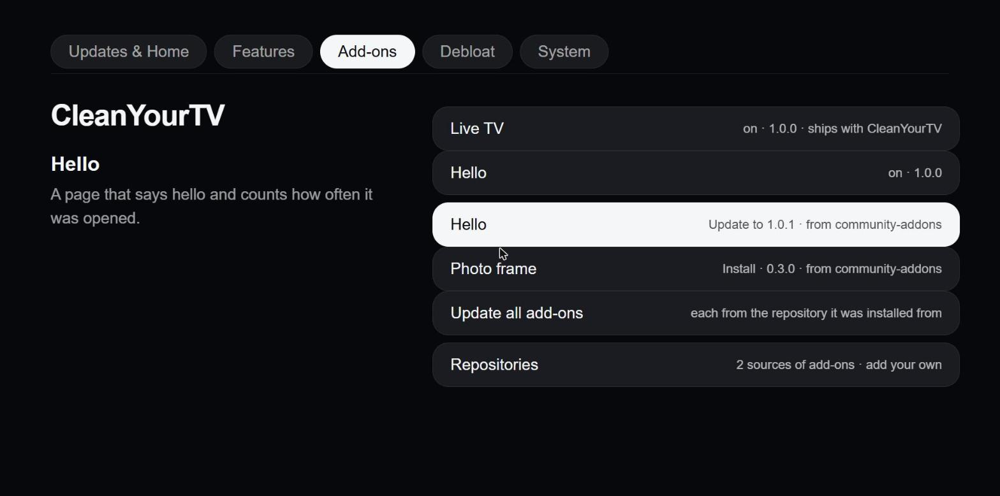
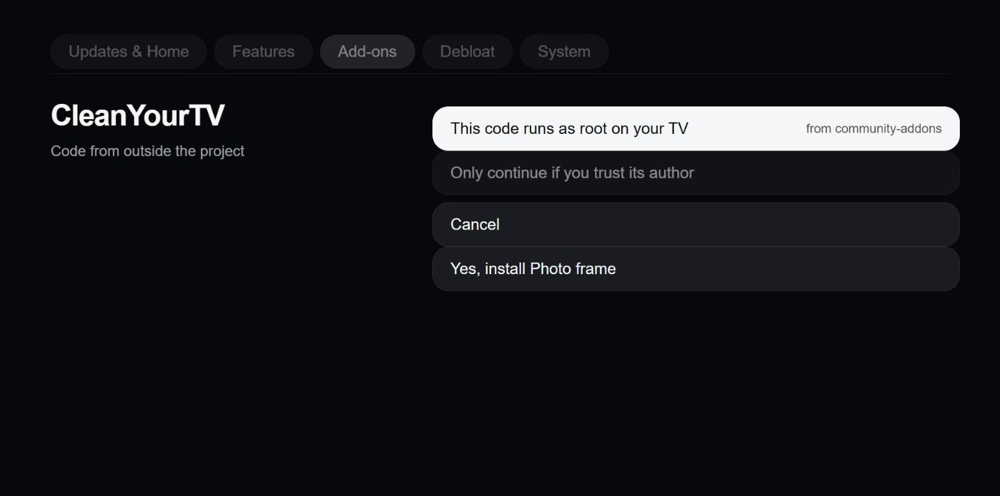

## Add-on repositories

Add-ons no longer depend on this project's catalog. The TV keeps a list of repositories (a GitHub repository or any https folder with an `index.json`); the project's own is the first entry and can be removed. Add, remove and update from the manager app (Add-ons > Repositories; the address is typed on your phone) or from a shell with `cytv-addons`. Adding a repository and installing from one other than the project's asks first, because a service add-on runs as root. A template repository with a sample add-on (`addons/template/`) and a page for people and AI assistants (Add-on repositories in the developer docs) show how to make one quickly.

In a shell on the TV, `node /media/developer/cleanyourtv/cytv-addons.js shortcut` once makes the command `cytv-addons` (`repos`, `repo-add`, `list`, `install`, `update`, `remove`).
