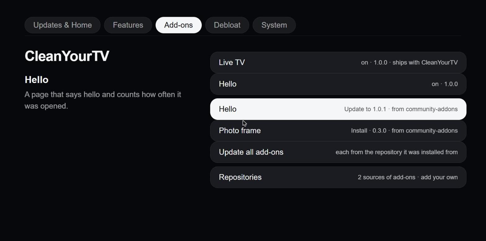
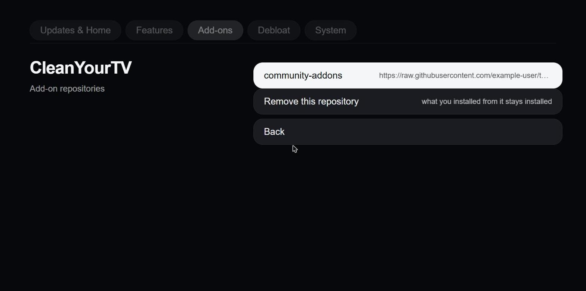
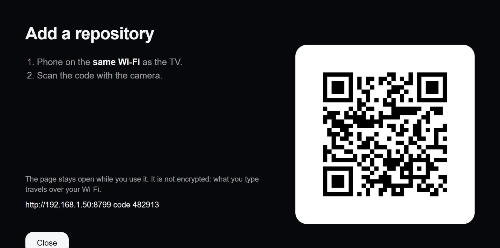
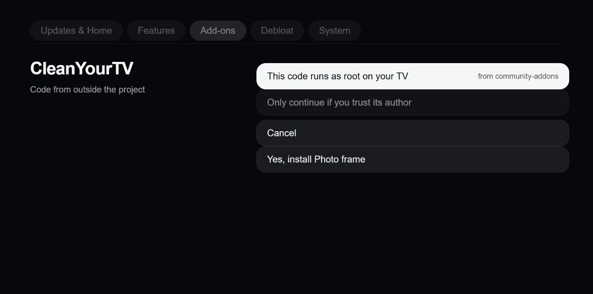
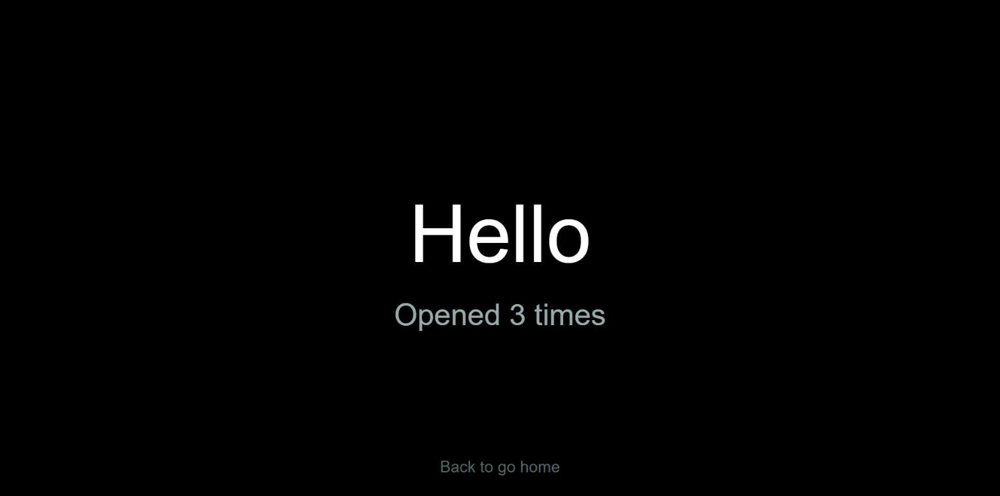

# Add-on repositories

Add-ons are not tied to this project. The TV keeps a **list of repositories**; a repository is a folder on the web (a GitHub repository is
enough) with an `index.json` and the add-ons beside it. The project's own catalog is the first entry of the list (`official`); it always
stays and cannot be removed, in the manager or in the service. Anyone can publish a repository, and anyone can add it to their TV.

!!! warning "Code from another repository runs as root on your TV"
    An add-on of `kind: "service"` runs inside CleanYourTV's service, with root rights: it can read and change anything on the TV and on
    your network. CleanYourTV checks that each file is the one the repository's index lists (SHA-256). That only shows that a file is the one
    the repository published; it does **not** show that its author is trustworthy, and the CleanYourTV project has not reviewed the add-ons
    of other repositories. Only continue for people and projects you trust.

    Before you add a repository, and before you install or update an add-on from a repository other than `official`, the manager (and
    the phone page, and `cytv-addons`) shows this warning and the add-on's permissions in plain words (what its `addon.json` asks for:
    its permissions and the calls to LG's services). The default is **Cancel**; the button that continues says what it does ("Install
    code from <repository>"). The service refuses without `confirm: true`, so a script cannot skip it by accident.
    Only `https://` repositories are accepted.

!!! note "What a repository sees"
    Every repository you add is contacted each time the add-ons list or a picture of an add-on is opened (and when you install or update),
    so its operator sees the TV's address, and when. The official repository is on GitHub; so is any repository you add with `user/repo`.

## Use a repository

### On the TV

Manager app > **Add-ons** > **Repositories**: the list; select one to remove it; **Add from your phone** shows a code and a QR code (page on
port 8800, open for ten minutes) and you type the address on the phone, tick the box that you trust it, and **Add**. Back in **Add-ons**,
the repository's add-ons are listed under the ones you have, with where they come from; selecting one asks first. **Update all add-ons**
installs newer versions, each from the repository it was installed from.










(The pictures show made-up repositories and add-ons.)

### From a shell (SSH)

Log in to the TV as root (`ssh root@<tv-ip>`; the Homebrew Channel set SSH up). The tool is
`/media/developer/cleanyourtv/cytv-addons.js`. Make it a command once; it stays (it goes to `/home/root/.local/bin`, which is on root's
`PATH` and survives reboots):

```sh
node /media/developer/cleanyourtv/cytv-addons.js shortcut
```

Log in again, then:

```sh
cytv-addons repos                            # the list
cytv-addons repo-add alice/tv-addons         # asks to confirm; -y says yes
cytv-addons list                             # everything the repositories offer
cytv-addons install clock alice-tv-addons    # asks to confirm for a repository other than official
cytv-addons update                           # newer versions of what is installed (-y: do not ask)
cytv-addons installed                        # with the repository each came from
cytv-addons remove clock
cytv-addons repo-rm alice-tv-addons          # what was installed from it stays
```

Without the shortcut, a session-only alias does the same: `alias cytv-addons='node /media/developer/cleanyourtv/cytv-addons.js'`.
The commands are the ones the manager uses, so what you do in one shows in the other.

An address is one of:

| Address | Reads |
|---|---|
| `user/repo` | `https://raw.githubusercontent.com/user/repo/main/` |
| `user/repo@branch` or `user/repo@branch/folder` | that branch, and a folder inside the repository |
| `https://github.com/user/repo` (also `.../tree/<branch>/<folder>`) | the same |
| `https://host/path` | any https folder that has `index.json` (a `/index.json` at the end is dropped) |

The repositories you added are `addonRepos` in `config.json` (`[{"name": "alice-tv-addons", "url": "https://..."}]`), changed only by the
service (`config.update`, logged as `addon-repos`). `official` is not stored: it is always there, always first, and a stored entry with that
name is ignored. Editing the file by hand works after a service restart; the service checks each entry.

### From a script

`GET /api/addons/repos`, `POST /api/addons/repos {add, name?, confirm}` or `{remove}`, `GET /api/addons/catalog`,
`POST /api/addons/install {id, repo?, confirm}`, `POST /api/addons/update {id?, confirm}`. A reply `{error, confirm: true}` means the confirm is
missing. See the table in [Add-ons](addons.md#api).

## Make a repository

The sample add-on (`hello`) opened as a page next to Home:



Copy [`addons/template/`](https://github.com/lasharor/cleanyourtv-WebOS/tree/main/addons/template) to a new GitHub repository. It is a
complete repository with one working sample add-on (`hello`: a page and a service part):

```
index.json            written by make-index.js
make-index.js         node make-index.js     (run after every change; --check says whether it is current)
.gitattributes        * -text: a file must reach the TV byte for byte as it was hashed (no line-ending conversion)
catalog/<id>/         addon.json, index.html, service.js (optional), preview.jpg (optional, 800 x 450, at most 600 KB)
```

Rules the service enforces when it installs (an add-on that breaks one is refused whole, nothing is installed):

- An id that the **official** repository has is the official add-on's: another repository cannot offer it (so a third-party repository cannot
  ship its own `spotify`), and the service refuses to install it from there. An id that two other repositories both have must say which
  one to take (`cytv-addons install <id> <repository>`; the manager always names it). If the official repository cannot be read, what other
  repositories offer is hidden until it can, because the ids cannot be checked.
- What the person is shown is what the add-on asks for: the index lists `kind`, `permissions` and the `luna` calls (`node make-index.js`
  writes them from `addon.json`), and the install is refused if the downloaded `addon.json` asks for something else.
- The folder name is the `id` in `addon.json`: lower case letters, digits and `-`, starting with a letter, 2 to 32 characters. Not `catalog`, `install`, `remove`, `sdk`,
  `book`, `preview`, `repos`, `update`; and not the id of a bundled add-on.
- `version` is `major.minor.patch` (`1.0.0`). Raise it when the files change: the TV offers an update only for a higher version.
- Every file of the add-on is in `index.json` with its SHA-256, at most 60 files, each at most 2 MB. `preview.*` is listed separately and never installed.
- The manifest is checked as in [Add-ons](addons.md#the-manifest). `kind: "service"` needs `entry.service`.
- Add-ons run on Node.js 8.12 (webOS 5 and 6) and Chromium 68 and up: no `?.`, `??`, `fs.promises`, global `URL`, no flex `gap`; the page is ES5.

## Recipe for an AI assistant: an add-on from an idea

Give the assistant this page, `addons/template/` and your idea. A prompt that works:

> Make a CleanYourTV add-on for this idea: *<idea>*. Start from `addons/template/catalog/hello/`. Create `catalog/<id>/addon.json`, `index.html`
> (ES5, large text for a TV, black background, include `/addon/sdk.js`, Back must go Home) and, only if the page needs the TV, `service.js`
> (Node 8.12, no network unless `"permissions": ["net.fetch"]`). Keep it small. Then run `node make-index.js` and show me the files. Do not
> install it on my TV; tell me the `cytv-addons repo-add` and `install` commands.

Checklist for the result:

1. `catalog/<id>/addon.json`: `id` equals the folder, `version` `1.0.0`, `kind` `page` unless the page needs the TV or the network,
   `entry.page` `index.html`, `tile` with `placement: "page"` and an icon from `home tv clock chart globe photo music play star heart cards grid hdmi settings addon`.
2. A page add-on needs no `service.js`. A service add-on's `service.js` exports `create(ctx)` and returns `{ handle(req, res, path, body) }`;
   the page calls it as `CYTV.api('/path', body)`. What `ctx` holds and what an add-on can provide (wallpapers, cards, channels for
   Live TV) is in [Add-ons](addons.md).
3. `node make-index.js` ran, and `index.json` is committed with the add-on.
4. Test: `node make-index.js --check`, open `index.html` in a desktop browser with a stub `CYTV` object, then on the TV `cytv-addons repo-add`,
   `cytv-addons install <id>` and look at it. Say plainly what was checked on a real TV and what was not.

## How it works (for contributors)

- `helper/addonrepos.js`: the address parser and the list rules (pure). `helper/addons.js`: reads each repository's `index.json` at the
  same time (one that fails is reported in `errors`, the others still list), installs through `entryFor(id, repo)`, and writes
  `addons/.sources/<id>.json` (`{repo, version}`) beside the add-on so that an update comes from the repository it was installed from. An add-on
  without a record counts as `official`. `helper/addonrepophone.js`: the phone page (port 8800).
- The confirm is enforced in the service (`needConfirm`), not only in the screens; its reply carries what is to be installed and what it may
  do (`addons: [{repo, id, name, version, kind, can}]`), which `cytv-addons` prints.
- `CYTV_ADDONS_URL` still replaces the address of `official` (tests, a mirror). `CYTV_REPOS_ALLOW_HTTP=1` is for the tests' stand-in servers only.
- `scripts/cytv-addons.js` is copied to the TV with the other scripts by `bootstrap.sh`.
