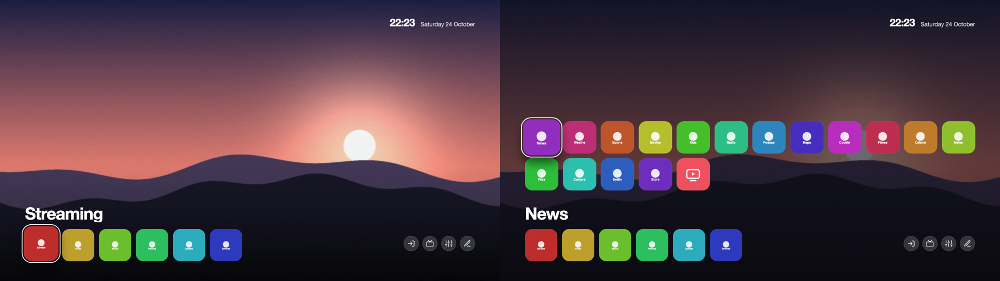

# Themes

A theme changes how the home screen looks: colours, the size of tiles and text, the number of columns, the clock, the ambient glow,
the speed of animations and a wallpaper. Themes apply to the launcher's home screen (dock, top shelf, grid, top buttons and menus).
Live TV, the Inputs picker and the notification cards keep their own look.

In the launcher, **Customise** > **Theme** lists the themes; choosing one applies it at once (a theme that is not on the TV yet is
downloaded first). **Go back to the previous theme** is at the bottom of the list. **Customise** > **Accent colour** sets the colour of
the focus ring and of the highlighted button or menu row, on top of any theme. The theme list shows the highlighted theme's
screenshot and description. The Inputs picker and the Live TV banner and guide follow the theme's colours, accent and typeface too.
Your own photos can replace a theme's background: see [Wallpapers](wallpapers.md).

## Where the themes come from

Themes are not part of the service. They are read from the [`themes/`](https://github.com/lasharor/cleanyourtv-WebOS/tree/main/themes)
folder of the GitHub repository (the `main` branch):

- The service downloads `themes/index.json` (the list) when you open **Theme**.
- Choosing a theme downloads its `theme.json` and its wallpaper to the TV (`/media/developer/cleanyourtv/themes/<id>/`) and keeps them,
  so it keeps working offline. Choosing it again downloads the latest version. If GitHub cannot be reached, the list shows the themes
  that are already on the TV and says why.
- **Classic** is built into the service and always works.
- A theme is data only (values, an image): the service checks every value, limits the file sizes (theme 32 KB, wallpaper 1.5 MB,
  screenshot 600 KB) and checks that the images are images. There is no script or CSS in a theme.

## The themes

| Theme | What it is |
|---|---|
| Classic | The original look: near-black, white focus, ten columns. The default. |
| Midnight | Deep blue with a wallpaper and a blue focus. |
| OLED black | Pure black and no ambient glow, so unlit pixels stay off. |
| Warm | Brown and amber, with the glow in the accent colour and a wallpaper. |
| Compact | Twelve columns of smaller tiles: more apps on screen. |
| Large print | Eight columns of big tiles and larger text. |
| Still | No animation and a quiet glow. |
| Bloom | A flower wallpaper with the dock in a glass panel at the bottom. Down moves the dock up and the apps appear below it, centred. It has slots for cards. |
| Horizon | A row of seven square apps along the bottom of a dusk landscape, the clock on the left and the buttons on the right at the top. Down moves the row up and shows all apps below it. It has slots for cards. |
| Pixel | Pixel art: a blocky typeface, square tiles and buttons, a yellow focus box and a sunset over a lake drawn in big pixels. Moves without animation, like an old console. |
| Couch | After [couch-tv](https://github.com/Seagey/couch-tv): five landscapes take turns every 20 seconds behind a large glass clock, the scenery in front of the digits; the date above the clock, round buttons top right, the apps on glass at the bottom; cards on frosted glass. Uses `clock.style`, `effects.scenes` and `cards.style`. |
| Lock Screen | A phone-style lock screen: a greeting and a big clock top left, and a small, translucent dock low in the corner over a calm blue landscape, so the picture fills the screen. Down moves the dock up and shows all apps below it. Turn Wallpapers on for your own photos. It has slots for cards (Customise > Cards): the greeting is one. |





The pictures are the launcher page rendered in a browser with each theme.

## Contributing a theme

Themes live in the repository, so a new one is a pull request:

1. Copy a folder from [`themes/`](https://github.com/lasharor/cleanyourtv-WebOS/tree/main/themes), for example `classic`, to `themes/<id>/`.
   The id is lower-case letters, digits and `-`.
2. Edit `theme.json`; the rest keeps its default, or the value of the theme named in `"extends"`.
3. Add `preview.jpg`: a screenshot of the home screen with your theme (16:9, about 800 px wide, at most 600 KB).
4. If it uses a wallpaper, add the image to the same folder (`.jpg`, `.png` or `.webp`, at most 1.5 MB, 1920 x 1080) and name it in
   `effects.wallpaper`. A typeface goes in the folder too, named in `type.fontFile`, with its licence file. A wallpaper or typeface
   must be your own work or under a licence that allows redistribution; say which in the pull request.
5. Run `node tools/theme-index.js` to update `themes/index.json`, then `node tools/test.js theme`: it checks every theme folder against the
   schema, that the screenshot is there, and that the index is up to date.
6. Open the pull request. Once it is merged into `main`, every TV can download the theme; no release is needed.

When you add a setting to the engine, add one row to `SCHEMA` in `helper/themeschema.js`, read its variable in the launcher's CSS (`app/src/css/`, then `node tools/build-pages.js`), and run
`node tools/theme-docs.js` to regenerate the table below.

## Making a theme with an AI assistant

An assistant such as Claude can write a theme from a description ("a calm blue theme with big tiles and the dock at the bottom"). Give it a
checkout of the repository (or these files) and the rules below.

**What it needs to read**
- The table of settings further down this page (or `SCHEMA` in `helper/themeschema.js`, the source of that table): every key, its range and its default.
- `themes/classic/theme.json` and one existing theme that is close to the goal, for example `themes/bloom/theme.json`.
- `themes/README.md` for the folder layout.

**Rules**
- A theme is data only: `themes/<id>/theme.json` with keys from the table, nothing else. No CSS, no script, no URLs. Unknown keys and
  out-of-range values are ignored or clamped, so a value that is not in the table has no effect.
- Positions and sizes are pixels on a 1920 x 1080 canvas. Keep the clock and the buttons at least 60 px from the screen edges (TVs can
  crop the picture), and make sure the dock fits: `dock.count` x `dock.w` plus the gaps must be at most the screen width (a panel adds
  `dock.panelPad` on each side).
- Text must stay readable: about 4.5 : 1 between `colors.ink` and the surfaces it sits on, and a visible focus ring. The text colour on the
  accent is chosen automatically.
- The TV's graphics chip is weak: no blurred or animated wallpapers, one static image at most, 1920 x 1080, at most 1.5 MB (`.jpg`,
  `.png` or `.webp`), kept in the theme's folder and named in `effects.wallpaper`. Prefer the dock and grid settings over tricks.
- A wallpaper must be original (drawn or generated for the theme) or under a licence that allows redistribution. Do not copy other
  people's artwork, screenshots or logos, and do not use brand names or trademarks in a theme.
- Use `"extends"` to start from another theme and list only what changes. Do not rename a setting group: `name`, `author`, `description` and
  `extends` are the theme's own fields.

**Steps**
1. Create `themes/<id>/theme.json` (and the wallpaper, if any).
2. Look at it: `node tools/theme-preview.mjs <id> --out /tmp/preview` renders the home screen with made-up apps in headless Chrome and writes
   `rest.png` (home), `grid.png` (the focus moved down into the apps) and `menu.png` (a menu). It needs Node.js 22 or newer and Chrome. Open
   the images, fix what looks wrong (overlapping parts, unreadable text, clipped tiles) and render again.
3. When it looks right, `node tools/theme-preview.mjs <id> --write` also writes `themes/<id>/preview.jpg` (needs `ffmpeg`), the screenshot the TV shows.
4. `node tools/theme-index.js` updates `themes/index.json`; `node tools/test.js theme` checks every theme folder, the screenshot and the index.
5. Commit and open a pull request; say where the wallpaper comes from.

**A prompt to start with**

> Create a theme for CleanYourTV. Read the settings table in `docs/themes.md`, `themes/classic/theme.json` and `themes/bloom/theme.json`.
> The theme: *describe the look and the layout you want*. Write `themes/<id>/theme.json` using only keys from the table (data only; ranges
> are enforced), generate an original wallpaper if it needs one (1920 x 1080, under 1.5 MB, saved in the theme's folder), render it with
> `node tools/theme-preview.mjs <id> --out /tmp/preview`, look at `rest.png`, `grid.png` and `menu.png`, fix problems and render again, then
> run `node tools/theme-preview.mjs <id> --write`, `node tools/theme-index.js` and `node tools/test.js theme`. Keep text readable and the
> wallpaper my own work.

## Theme files

A theme is `themes/<id>/theme.json` in the repository. Every key is optional.
A missing or invalid value keeps the value of the theme named in `"extends"`, or the default, which is the original look, so a
theme lists only what it changes. Positions and sizes are in pixels on a 1920 x 1080 canvas.

```json
{
  "name": "Midnight",
  "author": "CleanYourTV",
  "description": "Deep blue with a soft wallpaper and a blue focus.",
  "extends": "classic",
  "colors": { "night": "#060a18", "panel": "#101830", "ink": "#eaf0ff", "accent": "#7aa2ff" },
  "effects": { "glow": 0.8, "wallpaper": "midnight.jpg", "wallpaperDim": 0.25 }
}
```

### What a theme can set

Every part of the home screen has its own position and size, so themes can arrange the screen differently, not only recolour it:
the **clock**, the top **buttons** (`bar`), the large app **name**, the **dock** and the **grid**. Each can be anchored to the top
or bottom edge and aligned left, centre or right, with an offset. A dock at the bottom turns the grid into an overlay that opens
when the focus moves down into it (Back or Up closes it); a dock at the top leaves the grid below it, scrolling.

<!-- schema:start -->
| Key | Values | Default | |
|---|---|---|---|
| **colors** | | | |
| `colors.night` | `#rrggbb` | `#07080b` | Page background. |
| `colors.panel` | `#rrggbb` | `#14161b` | Toast background; menu rows are a lighter mix of it. |
| `colors.ink` | `#rrggbb` | `#f5f6f8` | Text. |
| `colors.accent` | `#rrggbb` | `#f5f6f8` | Highlight: the focused button and menu row and, unless `colors.focus` is set, the focus ring. |
| `colors.focus` | `#rrggbb` or empty | empty | Focus ring colour; empty uses the accent. |
| `colors.pill` | `#rrggbb` | `#ffffff` | Colour of the translucent top buttons, with `surface.pillAlpha`. |
| **surface** | | | |
| `surface.pillAlpha` | 0 to 0.6 | `0.09` | Opacity of the top buttons. |
| `surface.pillRing` | 0 to 0.8 | `0.1` | Opacity of the thin outline of the top buttons. |
| `surface.pillRadius` | 0 to 60 | `32` | Corner radius of the top buttons (pill style only). |
| `surface.menuAlpha` | 0.5 to 1 | `0.97` | Opacity of the dark layer behind menus. |
| `surface.rowRadius` | 0 to 50 | `30` | Corner radius of menu rows. |
| **type** | | | |
| `type.font` | `default`, `serif`, `mono` | `default` | The typeface: the TV's own, a serif or a monospace. |
| `type.fontFile` | a file name | none | A typeface of the theme: a file in the theme's folder, `.woff2`, `.woff`, `.ttf` or `.otf`, at most 400 KB, used for all text. Characters it lacks come from `type.font`. Its licence must allow redistribution; put the licence file in the folder too. |
| `type.scale` | 0.8 to 1.3 | `1` | Scale of the text of buttons, menus and tiles. |
| **clock** | | | |
| `clock.show` | `true` or `false` | `true` | Show the clock. |
| `clock.date` | `true` or `false` | `true` | Show the date beside or under the time. |
| `clock.greeting` | `true` or `false` | `false` | Show a greeting (Good morning / afternoon / evening, in the language) in capitals above the time. Needs the stacked layout. |
| `clock.layout` | `inline`, `stack` | `inline` | `inline`: the date beside the time; `stack`: under it. |
| `clock.anchor` | `top`, `bottom` | `top` | Which screen edge `clock.y` counts from. |
| `clock.align` | `left`, `center`, `right` | `left` | Which side `clock.x` counts from; `center` centres it. |
| `clock.x` | 0 to 900 | `96` | Distance from that side, in px (on a 1920 x 1080 canvas). Not used when centred. |
| `clock.y` | 0 to 900 | `54` | Distance from the top or bottom edge, in px. |
| `clock.scale` | 0.6 to 2.5 | `1` | Scale of the time. |
| `clock.dateScale` | 0.6 to 2 | `1` | Scale of the date. |
| `clock.style` | `text`, `glass` | `text` | `text`: the time as text; `glass`: a large glass clock centred near the top (Antonio, frosted with the background). With `effects.scenes` each scene places it, and the date moves above it; the other clock settings then only set the date. |
| **bar** | | | |
| `bar.show` | `true` or `false` | `true` | Show the top buttons (Inputs, Settings, Customise, ...). |
| `bar.style` | `pill`, `round`, `flat` | `pill` | `pill`: icon and label on a rounded button; `round`: icon only in a circle; `flat`: no background. |
| `bar.labels` | `auto`, `show`, `hide` | `auto` | Button labels: `auto` shows them except in the `round` style. |
| `bar.anchor` | `top`, `bottom` | `top` | Which screen edge `bar.y` counts from. |
| `bar.align` | `left`, `center`, `right` | `right` | Which side `bar.x` counts from. |
| `bar.x` | 0 to 900 | `96` | Distance from that side, in px. Not used when centred. |
| `bar.y` | 0 to 900 | `54` | Distance from the top or bottom edge, in px. |
| `bar.size` | 40 to 100 | `64` | Height of a button, in px. |
| `bar.gap` | 4 to 40 | `16` | Space between buttons, in px. |
| **shelf** | | | |
| `shelf.show` | `true` or `false` | `true` | Show the large name of the focused app. |
| `shelf.align` | `left`, `center`, `right` | `left` | Text alignment of the name. |
| `shelf.x` | 0 to 900 | `96` | Margin on both sides, in px. |
| `shelf.y` | 0 to 900 | `150` | Distance from the top edge, in px. |
| `shelf.scale` | 0.4 to 1.6 | `1` | Scale of the name. |
| `shelf.dockAlign` | `true` or `false` | `false` | Line the name up with the left edge of the dock, even when the dock is centred and the number of apps changes its width. Overrides `shelf.x` (`shelf.align` still sets the text alignment). Set `shelf.show` off to hide the name instead. |
| **dock** | | | |
| `dock.anchor` | `top`, `bottom` | `top` | Which screen edge `dock.y` counts from. |
| `dock.align` | `left`, `center`, `right` | `left` | Which side `dock.x` counts from; `center` centres the dock. |
| `dock.x` | 0 to 900 | `96` | Distance from that side, in px. Not used when centred. |
| `dock.y` | px, 0 to 1000 | empty | Distance from the top or bottom edge, in px. Empty: 360 from the top, 68 from the bottom. |
| `dock.count` | 3 to 8 | `4` | Apps in the dock. |
| `dock.w` | 120 to 500 | `408` | Width of a dock tile, in px. |
| `dock.h` | 100 to 300 | `230` | Height of a dock tile, in px. |
| `dock.gap` | 8 to 60 | `32` | Space between dock tiles, in px. |
| `dock.radius` | 0 to 80 | `36` | Corner radius of dock tiles. |
| `dock.panel` | 0 to 0.6 | `0` | Opacity of a translucent panel behind the dock tiles; 0 for none. |
| `dock.panelPad` | 0 to 60 | `24` | Space between the panel and the tiles, in px. |
| `dock.tileAlpha` | 0 to 1 | `1` | Opacity of the dock tile background; below 1 lets the wallpaper show through the tiles. |
| `dock.tileFrost` | 0 to 1 | `0` | Frost over the resting (unfocused) dock tiles and their icons; 0 for none. Calms loud tile colours without leaving a floating icon square, because the tile and its icon dim together. The focused tile keeps its full colour. |
| `dock.tileFrostColor` | `#rrggbb` | `#ffffff` | Tint of the dock-tile frost (`dock.tileFrost`): a light colour for a glassy frost, a dark one to deepen the tiles. |
| `dock.lift` | 0 to 40 | `10` | How far the focused dock tile rises, in px. |
| `dock.focusScale` | 1 to 1.3 | `1.05` | Scale of the focused dock tile. |
| **grid** | | | |
| `grid.mode` | `below`, `push`, `overlay` | `below` | `below`: the grid sits under the dock and scrolls (a dock at the bottom behaves as `push`); `push`: the grid sits under the dock out of sight, and when the focus moves down into it the dock moves up to `grid.dockUp` and the grid appears below it; `overlay`: the grid opens over the screen above the dock. |
| `grid.dockUp` | 0 to 700 | `220` | `push` mode: where the dock stops, counted from the top of the screen, while the grid has the focus, in px. |
| `grid.align` | `left`, `center` | `left` | `center` centres every row of tiles, also a last row that is not full. |
| `grid.cols` | 4 to 14 | `10` | Columns. |
| `grid.tileH` | 80 to 240 | `151` | Height of a tile, in px; the width follows from the columns. |
| `grid.gapX` | 6 to 60 | `24` | Horizontal space between tiles, in px. |
| `grid.gapY` | 6 to 60 | `26` | Vertical space between tiles, in px. |
| `grid.radius` | 0 to 100 | `34` | Corner radius of tiles. |
| `grid.x` | 0 to 900 | `96` | Distance of the grid from the left edge, in px. |
| `grid.width` | 600 to 1920 | `1728` | Width of the grid, in px. |
| `grid.y` | px, 0 to 1000 | empty | Distance of the grid from the top edge, in px. Empty: under the dock, or 290 for an overlay. |
| `grid.clipTop` | 0 to 600 | `300` | Where scrolled rows disappear at the top, in px (`below` mode). |
| `grid.focusScale` | 1 to 1.4 | `1.12` | Scale of the focused tile. |
| `grid.overlayDim` | 0 to 1 | `0.95` | Opacity of the layer behind the overlay grid. |
| `grid.overlayH` | 200 to 900 | `510` | Visible height of the overlay grid before it scrolls, in px. |
| **tile** | | | |
| `tile.gloss` | 0 to 1 | `0` | A light highlight on every tile. |
| `tile.border` | 0 to 0.6 | `0` | Opacity of a thin outline on every tile. |
| `tile.ringWidth` | 0 to 10 | `4` | Width of the focus ring, in px; 0 for none. |
| `tile.ringOffset` | 0 to 14 | `4` | Space between a tile and its focus ring, in px. |
| `tile.iconScale` | 0.6 to 2 | `1` | Scale of the icon inside the tile. |
| **effects** | | | |
| `effects.glow` | 0 to 1 | `1` | Strength of the ambient glow at the top. |
| `effects.glowColor` | `app`, `accent` | `app` | `app`: taken from the focused icon; `accent`: the accent colour. |
| `effects.speed` | 0 to 2 | `1` | Animation speed multiplier; 0 switches the animations off. |
| `effects.wallpaper` | a file name | none | A file name in `themes/wallpapers/`: `.jpg`, `.png` or `.webp`, at most 1.5 MB; drawn at 1920 x 1080. |
| `effects.wallpaperDim` | 0 to 0.9 | `0.4` | How far the wallpaper is darkened with the background colour. |
| `effects.scenes` | `off`, `couch`, `custom` | `off` | `couch`: five landscapes shipped with the launcher take turns behind Home (Night, Golden hour, Waterline, Fog, Dawn); with `clock.style` glass the scenery stands in front of the clock. Takes the place of the wallpaper and of Wallpapers. `custom`: the theme brings its own scenes as a `"scenes"` array in `theme.json`. |
| `effects.sceneSecs` | 10 to 600 | `20` | Seconds each scene stays (`effects.scenes`). |
| **cards** | | | |
| `cards.style` | `flat`, `glass` | `flat` | `glass`: the weather and Home Assistant cards sit on frosted glass (a blurred copy of the scene behind them, no live blur). |
<!-- schema:end -->

### Scenes and the glass clock

`effects.scenes` `couch` shows five landscapes that ship with the launcher (Night, Golden hour, Waterline, Fog, Dawn), each for
`effects.sceneSecs` seconds, cross-faded. They take the place of `effects.wallpaper` and of [Wallpapers](wallpapers.md).
`clock.style` `glass` draws the time as a large glass clock in Antonio: its fill is a blurred, brightened copy of the scene, with a thin
rim and a sheen. In four scenes the scenery is cut out of the photo and drawn over the clock, so the peaks stand in front of the digits;
in Waterline the clock sits on the water with a reflection under it. Each scene places the clock and the date above it, so the other
`clock.*` settings then only set the date's size and whether it shows. Without scenes the glass clock has a white frosted fill. After
10 pm the scenes dim a little. Everything is drawn once a minute; only opacity animates. The scenes and the clock come from
[couch-tv](https://github.com/Seagey/couch-tv) (MIT; the scenes were generated for that project and are free to use, the typeface is
Antonio under the SIL Open Font License, see `THIRD-PARTY.md`).

`effects.scenes` `custom` lets a theme bring its own landscape images instead of the five built-in ones. Add a `"scenes"` array to
`theme.json` and put the image files in the theme folder:

```json
"effects": { "scenes": "custom", "sceneSecs": 25 },
"scenes": [
  {
    "id": "lake",
    "image": "lake.jpg",
    "glass": "lake-glass.jpg",
    "front": "lake-front.webp",
    "clock": { "top": 463, "size": 360 },
    "date":  { "top": 110 },
    "water": 0.687
  },
  {
    "id": "city",
    "image": "city.jpg",
    "glass": "city-glass.jpg"
  }
]
```

| Key | Required | What it does |
|---|---|---|
| `id` | yes | Short identifier (`a–z`, `0–9`, `-`). Must be unique within the list. |
| `image` | yes | Main landscape file (`.jpg` or `.webp`, up to 3 MB). 1920 × 1080 is the native size; a 4K TV renders Home at 3840 × 2160 (device pixel ratio 2), so 2560 × 1440 or higher gives a sharper result. |
| `glass` | yes | A blurred copy of the same image, used as the fill of the glass clock and glass cards. |
| `front` | no | A foreground cut-out (`.webp` with transparency) drawn over the clock, so scenery stands in front of the digits. |
| `clock.top` | no | Distance from the top of the screen to the clock, in px (default 150). |
| `clock.size` | no | Font size of the clock digits, in px (default 400). |
| `date.top` | no | Distance from the top of the screen to the date line, in px (default 96). |
| `water` | no | A 0–1 fraction of the screen height where the water surface is. When set, the clock sits on the water with a blurred reflection below the line. |
| `darkSky` | no | `true`: the top buttons switch to a dark style when this scene is showing, so they stay readable against a bright sky. The same treatment the built-in Fog scene uses. |

Up to 10 scenes are accepted; extras are ignored. A scene whose files are missing or whose filenames contain path characters is skipped silently. One scene means no cycling. The TV downloads the image files from the theme's GitHub folder together with `theme.json` when the theme is installed.

`cards.style` `glass` puts the weather and Home Assistant cards on frosted glass: the same blurred copy of the current scene, placed
where the card is, under a dark tint. Without scenes it is a plain translucent panel.

### Slots for cards

A theme can mark places where **cards** go: small widgets the user chooses in **Customise** > **Cards** (greeting, weather,
text and Home Assistant cards). A theme without slots shows no cards and has no Cards row in Customise. Slots are a
list in `theme.json`:

```json
"slots": [
  { "id": "greeting", "anchor": "top", "align": "left", "x": 102, "y": 70, "w": 900, "h": 26, "card": "greeting", "grid": "keep" },
  { "id": "side", "anchor": "top", "align": "right", "x": 96, "y": 170, "w": 520, "h": 520 }
]
```

| Key | Values | What it does |
|---|---|---|
| `id` | lower-case letters, digits and `-` | The name of the place. Use `greeting` (above the clock), `clock-side` (beside the clock), `side` (a column on the right) or `row` (above the dock) where they fit: the card a user chose stays when they switch to another theme with the same slot, and these four have a name in every language. |
| `anchor`, `align`, `x`, `y` | as for the clock | Where the slot's box is, counted from that side of the 1920 x 1080 screen; `x` is not used when centred. |
| `w`, `h` | px | The size of the box. |
| `card` | a card type, for example `greeting` | What the slot shows until the user chooses something else. Without it the slot starts empty. |
| `grid` | `keep` or `hide` | `keep` leaves the card on screen while the app grid is open; by default it fades out then. |

At most eight slots; values out of range are clamped and a slot with a bad or repeated `id` is left out. A theme that extends another
keeps its slots unless it has its own `"slots"` (an empty list removes them). In a right-to-left language the slots are mirrored
like the rest of the screen.

A theme file holds values only. The service checks every value against the table and clamps numbers to their range; there is no CSS
and no script, and a wallpaper is accepted only as a plain file name from the theme's folder that is also a real image of the
right type. Anything else is ignored. The launcher draws the wallpaper once and nothing blurs or filters it, because the TV's GPU is weak.

From a shell on the TV:

```sh
curl localhost:8765/api/theme/list
curl -X POST localhost:8765/api/theme/set -d '{"id":"midnight","accent":"#ff8a3d"}'   # downloads the theme if it is not on the TV
curl -X POST localhost:8765/api/theme/revert
```
