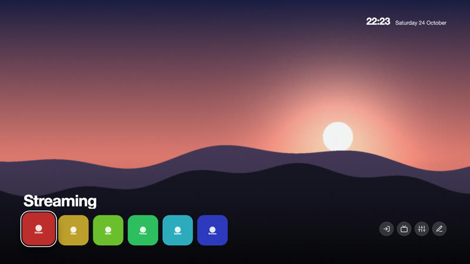

# Themes

The themes of CleanYourTV. A theme changes how the home screen looks: colours, the position and size of the clock, buttons, app name,
dock and grid, text, effects and a wallpaper. In the manager app, **Theme** lists them with these screenshots; the TV reads this folder
from GitHub (the `main` branch) and downloads a theme when you choose it. A new theme is available to every TV as soon as it is merged,
without a release.

| File | What it is |
|---|---|
| `index.json` | The list the TV downloads. Generated: `node tools/theme-index.js`. |
| `<id>/theme.json` | The theme: colours, positions, sizes, effects. Every key is optional. |
| `<id>/preview.jpg` | The screenshot shown in the manager. |
| `<id>/<wallpaper>` | The wallpaper, if the theme uses one. |

Every setting, with its range and default, is in the [Themes page of the documentation](https://lasharor.github.io/cleanyourtv-WebOS/themes/).

## Make your own

A step-by-step guide, including how to make one with an AI assistant, is on the [Themes page](https://lasharor.github.io/cleanyourtv-WebOS/themes/#making-a-theme-with-an-ai-assistant). The short version:

1. Copy a folder, for example `classic/`, to `<id>/` (lower-case letters, digits and `-`).
2. Change only what you want to change in `theme.json`. A missing value keeps the default, or the value of the theme named in `"extends"`.
3. Put a screenshot of the result in `preview.jpg` (16:9, about 800 px wide, at most 600 KB). `node tools/theme-preview.mjs <id> --write` makes it.
4. If it uses a wallpaper, put a `.jpg`, `.png` or `.webp` (at most 1.5 MB, 1920 x 1080) in the folder and name it in `effects.wallpaper`.
5. Run `node tools/theme-index.js`, then `node tools/test.js theme`.
6. Open a pull request. A wallpaper must be your own work or under a licence that allows redistribution; say which.

## The themes

### Classic

The original look: near-black, white focus, ten columns.

Folder: [`classic/`](classic/)

### Bloom

A flower wallpaper with the dock in a glass panel at the bottom. Down moves the dock up and the apps appear below it, centred.

Folder: [`bloom/`](bloom/)

### Horizon

Everything along the bottom edge of a dusk landscape: the app name, a row of seven square apps and round buttons. Down opens all apps over the picture.

Folder: [`horizon/`](horizon/)

### Compact

Twelve columns of smaller tiles: more apps on screen.

Folder: [`compact/`](compact/)

### Large print

Eight columns of big tiles and bigger text, easier to read from the sofa.

Folder: [`large/`](large/)

### Midnight

Deep blue with a soft wallpaper and a blue focus.

Folder: [`midnight/`](midnight/)

### OLED black

Pure black, no ambient glow: unlit pixels stay off.

Folder: [`oled/`](oled/)

### Still

No animation and a quiet glow, for anyone who prefers a calm screen.

Folder: [`still/`](still/)

### Warm

Brown and amber with the glow in the accent colour.

Folder: [`warm/`](warm/)
